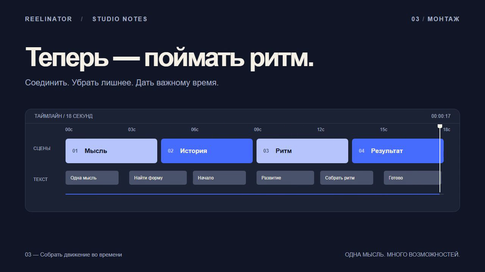

# REELINATOR

**Создание и монтаж видео через Codex и Claude Code. Сцены, нарезка, субтитры и звук — в одном редактируемом проекте на Remotion и FFmpeg.**

Откройте репозиторий в агенте, дайте идею или исходники и опишите результат.
Агент работает с файлами проекта; общий CLI готовит медиа, собирает превью и экспортирует видео.
Следующая правка продолжает этот же проект.

> В финале замени заголовок. Субтитры сделай крупнее. Остальные сцены сохрани.

[Видео из одной идеи](examples/idea-to-film/final-master.mp4) ·
[Превью](examples/idea-to-film/preview.mp4) ·
[Код этого ролика](video/projects/idea-to-film/Composition.tsx) ·
[Результаты проверок](examples/ACCEPTANCE.md)

[](examples/idea-to-film/preview.mp4)

## Зачем этот репозиторий

[FFmpeg](https://ffmpeg.org/ffmpeg.html) обрабатывает медиа,
[Remotion](https://www.remotion.dev/docs/) позволяет описывать видео кодом и работать с coding-агентами.
REELINATOR добавляет к ним готовый порядок работы: отдельные проекты, сохранённые монтажные
решения, пересчёт субтитров, превью, обработку звука и проверку экспорта.

Это полезно, когда задача включает **создание сцен и несколько итераций монтажа**:
объясняющий ролик со схемой, запись с титрами и графическими вставками, демонстрацию интерфейса.
В одном проекте можно сочетать исходное видео, аудио, изображения и программную анимацию.
Для графики исходная съёмка не обязательна.

Для разовой конвертации достаточно FFmpeg. Для автоматической нарезки записи по тишине
есть специализированные инструменты, например [auto-editor](https://github.com/WyattBlue/auto-editor).
REELINATOR стоит выбирать, когда нужен **весь цикл работы с агентом — от материала или идеи
до повторно собираемого проекта и проверенного видео**.

## Что уже учтено

| Задача | Как она решена |
|---|---|
| Вернуться к ролику и изменить конкретную сцену | Сцены хранятся в TSX, монтаж и текст — в JSON. Правка сохраняется в источнике следующей сборки. |
| Вести несколько роликов | У каждого проекта свои исходники, настройки, расшифровка, кэш и результаты. |
| Изменить нарезку или скорость | Тайминги видео, звука и субтитров пересчитываются из времени исходника. Граница внутри слова по расшифровке останавливает подготовку. |
| Сохранить исправленную расшифровку | Обычная подготовка использует сохранённый текст. Повторное ASR требует явного `--replace`, если в файле уже есть слова. |
| Не принять повреждённую сборку за готовую | Перед обновлением последнего успешного экспорта проверяются декодирование, число кадров, fps, размеры и длительности потоков. Ошибка сохраняет предыдущий результат. |
| Не потерять звук на границах частей рендера | Звук рендерится целиком в PCM; мастер проходит двухпроходную нормализацию и одно AAC-кодирование. |
| Быстро проверить правку | Studio, рендер отдельного кадра и черновое превью в половинном разрешении. |
| Работать из двух агентских сред | Общие `AGENTS.md`, навыки, файлы проекта и CLI для Codex и Claude Code. |

Монтажные решения остаются доступными для проверки: какие фрагменты сохранены, что написано
в субтитрах, из чего собрана сцена. Успешный экспорт содержит мастер, превью, технический
отчёт и снимок исходного кода сборки. Исходные медиа хранятся отдельно в проекте.

## Установка и первый рендер

Нужны **Node.js 22+**, **Python 3.11+**, **FFmpeg и ffprobe 7+** в PATH.
Для работы обычными словами нужен настроенный Codex или Claude Code.

```sh
git clone https://github.com/medoedov/reelsinator.git
cd reelsinator
npm ci --prefix video
python reel.py doctor
python reel.py render idea-to-film
```

Первый рендер скачает Chrome Headless Shell. Готовый пример появится в
`video/projects/idea-to-film/out/runs/`; `out/latest.json` укажет на успешную версию.
Если Python установлен как `python3`, используйте эту команду вместо `python`.
[Настройка FFmpeg на Windows и переменные окружения →](docs/workflow.md#окружение)

Для первого примера не нужны исходное видео, модель распознавания или сервис генерации.
Рендер и обработка медиа выполняются локально. Работа самого coding-агента зависит от
выбранной среды и её настроек.

## Как работать

**Из идеи.** Откройте папку в агенте:

> Сделай вертикальный ролик на 20 секунд: как запрос проходит через кэш.
> Нужны схема, короткие русские подписи и анимация движения запроса. Без озвучки.

Агент создаёт проект и разрабатывает его сцены под задачу. Команда `new` сама по себе
создаёт стартовую композицию; сценарий и анимацию пишет агент.

**Из записи.** Дайте агенту файл и монтажную задачу. Для точного выбора фрагментов есть CLI:

```sh
python reel.py new interview --width 1080 --height 1920
python reel.py cut interview --source "take.mp4" --keep "0.2:5.1,7.0:12.4" --fit cover
python reel.py preview interview
python reel.py render interview
```

Отдельная аудиозапись тоже подходит. Для субтитров можно использовать исправленный
`transcript.json` или подключить локальный whisper.cpp. Текст и тайминги доступны для правки.
Автоматическое сжатие пауз (`cut --auto`) даёт черновую нарезку; выбор дублей и смысловые
стыки требуют проверки по записи.

**Для следующей итерации.** Попросите изменить нужную часть и проверьте результат:

```sh
python reel.py studio interview
python reel.py still interview --frame 60
python reel.py preview interview
```

Все рабочие файлы находятся в `video/projects/<id>/`:

```text
Composition.tsx    сцены и анимация
project.json       формат и оформление
edit.json          интервалы исходника и скорость
transcript.json    исправленные слова и исходные тайминги
public/assets/     импортированные материалы
out/latest.json    последний успешный экспорт
```

[Подробно: монтаж, субтитры, звук, референсы и экспорт →](docs/workflow.md)

## Что проверено

В репозитории есть готовые видео и их исходники:

- [Ролик из идеи](examples/idea-to-film/final-master.mp4): 18 секунд программной графики, 1280×720, 30 fps.
- [Точечная правка](examples/edit-verification.json): изменение финального заголовка с проверкой сохранности остальных сцен.
- [Технический монтаж](examples/media-check/final-master.mp4): два выбранных фрагмента, пересчитанные субтитры и нормализованный звук. Материал синтетический.
- [Вертикальный проект](examples/fresh-graphics/final-master.mp4): рендер стартовой композиции без исходных медиа.

Пройдены 25 Python-тестов, ESLint и TypeScript. Медиа-тесты используют реальные FFmpeg/ffprobe:
проверяют дробные склейки, сохранение последнего фрагмента, смещения потоков, звуковые события
и сохранность принятого экспорта при ошибках.

**Текущие границы:** сквозные примеры проверены на Windows через Codex. Работа на macOS/Linux,
продолжение проекта в Claude Code и качество ASR на реальной речи ещё не подтверждены.
Визуальный просмотр и прослушивание остаются отдельной частью проверки ролика.
3D, маттинг и дополнительные сервисы подключаются под задачу; проверенных примеров с ними пока нет.

[Полный отчёт проверок](examples/ACCEPTANCE.md) · [Технические решения](TECH_DECISIONS.md)

## Разработка

```sh
npm run lint --prefix video
python -m unittest discover -s tests -v
python scripts/sync-skills.py --check
```

Общие компоненты — `video/src/project/`, операции — `video/scripts/`, шаблон нового
проекта — `video/templates/project/`. Инструкции агентов находятся в `AGENTS.md`;
канонические навыки — в `skills/`.

Код — [MIT](LICENSE). [Условия зависимостей и материалов](docs/LICENSES.md).
